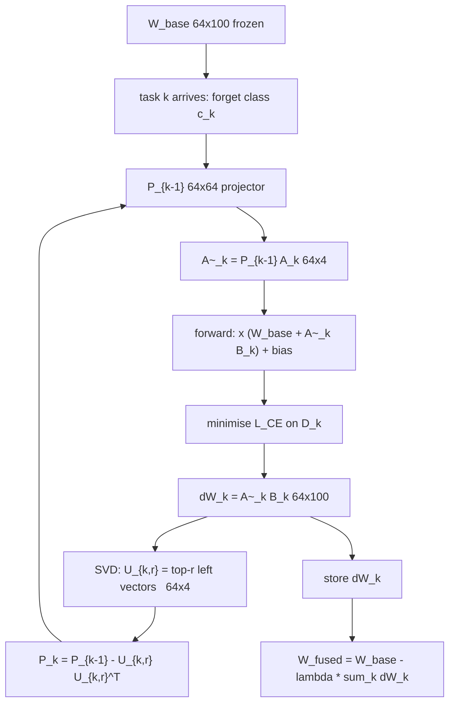

# Paper Spec

> **Independent replication, in progress.** This page is part of an unaffiliated attempt to
> reproduce [arXiv:2604.12526](https://arxiv.org/abs/2604.12526). It is not the work of the paper's authors and carries no
> endorsement from them. Readings marked as discrepancies are our interpretation of the published
> text and may be wrong. Corrections are welcome in [Issues](https://github.com/sumitasthana/DSR/issues), and will be recorded
> in the revision log rather than quietly edited.

| | |
|---|---|
| Paper | Orthogonal Subspace Projection for Continual Machine Unlearning via SVD-Based LoRA |
| Authors | Y. Rahulamathavan, N. Iqbal, J. Hu, S. Lambotharan |
| Identifier | [arXiv:2604.12526v1 [cs.LG]](https://arxiv.org/abs/2604.12526) |
| Posted | 2026-04-14 |
| Status | preprint, stated as submitted to the IEEE; no v2 as of 2026-11-08 |
| Length | 5 pages, letter format |
| Official code | none found; arXiv page inspected 2026-11-07 |
| This spec covers | Sections I to V, Eqs. 1 to 3, Lemma 1, Table I, Figs. 2 and 3 |

## How to read this page

This is a model of the paper, not a summary of it. Every symbol and claim carries a tag saying how
far we have checked it:

- `[UNVERIFIED]` taken from the text or the maths, not yet tested.
- `[INFERRED: reason]` the paper omitted it and we made a documented guess.
- `[DISCREPANCY: id]` we found a contradiction, between parts of the paper or against our tests.
  The id points into the register in Section 4.
- `[VERIFIED: ref]` confirmed by a unit test, a notebook run, or a derivation. The ref names it.

Paths like `tests/test_projection.py` and `notebooks/01_projection_budget_checks.ipynb` refer to
files in the [repository](https://github.com/sumitasthana/DSR).

A discrepancy is a claim about the published text as we read it. Several are arithmetic and we are
confident in them. Others turn on what the authors meant by an undefined term, and those could
resolve either way once the detail is known.

---

## Section 1. Symbol Registry

| Symbol | Domain / shape | Meaning | Source | Tag |
|---|---|---|---|---|
| `W_base` | `R^{d_in x d_out}` | Frozen weights of the single target layer. Final classification head. | Sec. III | `[VERIFIED: src/lora.py LoRAHead.weight]` |
| `d_in` | scalar, 64 | Input width of the target layer. CIFAR-100 ResNet-20 feature dimension. | Sec. IV-B | `[VERIFIED: config.yaml model.feature_dim]` |
| `d_out` | scalar, 100 | Number of classes. | Sec. IV-B | `[VERIFIED: config.yaml model.classes]` |
| `N` | scalar | Number of sequential unlearning tasks. 3 for MNIST, up to 30 for CIFAR-100. | Sec. IV | `[UNVERIFIED]` |
| `k` | 1..N | Task index. | Sec. III | `[VERIFIED]` |
| `D_k` | distribution | Data to forget at task k. One class per task. | Sec. III | `[VERIFIED]` |
| `D_retain` | distribution | Data whose behavior must be preserved. Membership never stated. | Sec. III | `[INFERRED: see D6 and D7]` |
| `r` | scalar, 4 | LoRA rank per task. | Sec. IV-B | `[VERIFIED: config.yaml projection.rank]` |
| `A_k` | `R^{d_in x r}` | LoRA input factor for task k. | Sec. III | `[VERIFIED: src/lora.py LoRAHead.a]` |
| `B_k` | `R^{r x d_out}` in Sec. III; `R^{100 x 4}` in Sec. IV-B | LoRA output factor. | Sec. III, IV-B | `[DISCREPANCY: D1]` |
| `dW_k` | `R^{d_in x d_out}` | Task update, `A_k B_k`. | Sec. III | `[VERIFIED]` |
| `lambda` | scalar; 0.5 and 1.0 in Table I; 2.0 in Fig. 3 | Fusion strength in Eq. 1. | Eq. 1, Sec. IV | `[DISCREPANCY: D4]` |
| `W_fused` | `R^{d_in x d_out}` | Deployed layer after subtracting all updates. | Eq. 1 | `[VERIFIED: tests/test_fusion.py::test_fused_equals_explicit_subtraction]` |
| `U_k, S_k, V_k` | SVD factors of `dW_k` | Full SVD of the task update. | Eq. 2 | `[VERIFIED]` |
| `U_{k,r}` | `R^{d_in x r}` | Top-r left singular vectors of `dW_k`. | Eq. 2 | `[DISCREPANCY: D10]` |
| `P_k` | `R^{d_in x d_in}` | Cumulative projector onto unused input directions. `P_0 = I`. | Eq. 3 | `[VERIFIED: tests/test_projection.py::test_recursive_projection_and_exhaustion]` |
| `A~_k` | `R^{d_in x r}` | Projected input factor, `P_{k-1} A_k`. | Sec. III-B2 | `[VERIFIED: src/lora.py LoRAHead.effective_update]` |
| `A^_k, B^_k` | same as `A_k, B_k` | Converged unconstrained factors, post-hoc variant only. | Sec. III-B1 | `[VERIFIED: tests/test_projection.py::test_posthoc_projection_and_nonfinite_rejection]` |
| `L_CE` | scalar | Cross-entropy loss, minimised on `D_k`. | Sec. III-B | `[DISCREPANCY: D11]` |
| `f(x; W)` | `R^{d_out}` | Forward pass with the given layer weights. | Sec. III-B | `[VERIFIED]` |
| `alpha(x)`, `G(x; theta_G)` | `[0,1]^N`, network | MoE router gate and router network. Baseline only, not our method. | Sec. II | `[UNVERIFIED]` |

Symbols the paper never introduces but the experiments need: optimizer, learning
rate, epochs, batch size, initialisation of `A_k` and `B_k`, class ordering, and
MLP hidden size. All `[INFERRED]`, recorded in [Assumptions](Assumptions).

---

## Section 2. Dataflow and Shape-Annotated Pseudocode



```python
# Shapes for CIFAR-100 / ResNet-20: d_in = 64, d_out = 100, r = 4.

P = torch.eye(d_in)                           # [64, 64]  P_0 = I

for k in range(1, N + 1):
    A = normal(std=0.01, size=(d_in, r))      # [64, 4]   INFERRED init
    B = zeros((r, d_out))                     # [4, 100]  INFERRED init

    for step in range(epochs):                # epochs INFERRED
        A_tilde = P @ A                       # [64,64]@[64,4] -> [64, 4]
        dW      = A_tilde @ B                 # [64,4]@[4,100] -> [64, 100]
        logits  = x @ (W_base + dW) + bias    # [N_b,64]@[64,100] -> [N_b, 100]
        loss    = cross_entropy(logits, y)    # y drawn from D_k
        loss.backward()                       # grad_A = P @ grad_A_tilde  (Lemma 1)
        opt.step()

    dW_k = (P @ A) @ B                        # [64, 100]
    U, S, Vt = svd(dW_k)                      # U: [64, 64], S: [64]
    U_r = U[:, :r]                            # [64, 4]   see D10
    P   = P - U_r @ U_r.T                     # [64, 64]  Eq. 3
    updates.append(dW_k)

W_fused = W_base - lam * sum(updates)         # [64, 100]  Eq. 1
```

Our implementation differs from the literal recursion in one documented way.
`src/projection.py` keeps an orthonormal occupied basis `Q`, applies joint QR
after each addition, and rebuilds `P = I - Q Q^T` in float64. For mutually
orthogonal feasible updates this equals Eq. 3 and avoids subtraction drift.
`[VERIFIED: tests/test_projection.py::test_recursive_projection_and_exhaustion]`

`SubspaceProjector.reserve` returns the effective rank it consumed. That return
value is the instrument for test T1 in Section 4.

---

## Section 3. Math Mechanics and Edge Cases

### 3.1 Static fusion (Eq. 1)

$$ W_{\text{fused}} = W_{\text{base}} - \lambda \sum_{k=1}^{N} \Delta W_k $$

`lambda` scales the total subtraction only. It does not enter training, the SVD,
or Eq. 3. Therefore `rank(P_k)` must be independent of `lambda`.
`[DISCREPANCY: D4]`
`[VERIFIED: notebooks/01_projection_budget_checks.ipynb, test T7]` Free-rank curves
at scales 0.5, 1.0 and 2.0 were identical element for element. This holds even under
the generous reading where lambda enters training, because scaling a matrix does not
change its column space.

### 3.2 Subspace extraction (Eq. 2) and projector update (Eq. 3)

$$ \Delta W_k = U_k S_k V_k^{T}, \qquad P_k = P_{k-1} - U_{k,r} U_{k,r}^{T}, \qquad P_0 = I $$

`P_k` stays a valid orthogonal projector only when
`range(U_{k,r})` is contained in `range(P_{k-1})`. Both algorithm variants satisfy
this for full-rank updates, because `dW_k` is built from `P_{k-1} A_k` and so its
column space already lies inside `range(P_{k-1})`.
`[VERIFIED: tests/test_projection.py::test_recursive_projection_and_exhaustion]`

### 3.3 The capacity budget

Each task removes `rank(U_{k,r})` directions from a space of dimension `d_in`.
If every update has full effective rank `r`:

$$ \operatorname{rank}(P_k) = d_{in} - k r, \qquad N_{\max} = \left\lfloor \frac{d_{in}}{r} \right\rfloor $$

For CIFAR-100: 64 divided by 4 is 16.
`[VERIFIED: tests/test_projection.py::test_recursive_projection_and_exhaustion]`
Three seeded full-rank sequences exhaust all 64 dimensions after 16 rank-4 updates.

Boundary behavior at `k > N_max`. Once `rank(P_k) = 0`, we have `P_k = 0`, so
`A~_k = P_{k-1} A_k = 0`, so `dW_k = 0`. The forward pass reduces to the frozen
base layer and the gradient on `A_k` is zero by Lemma 1. Task `k` cannot change
the model at all.

Consequence for the paper's Table I, which reports `N = 20` and `N = 30`: tasks
17 to 30 are no-ops under the paper's own equations. Recorded as `[DISCREPANCY: D3]`.

`[VERIFIED: notebooks/01_projection_budget_checks.ipynb, test T4]` for the mechanism.
At rank 4, tasks 1 to 16 each reserved exactly 4 directions, and tasks 17 to 20
produced update norms near `1.2e-13` against `1.6e+02` for task 1. Sweeping the rank
over {2, 4, 8} moved the budget to 32, 16 and 8 tasks, matching `floor(d_in / r)` in
every case, so the limit is a rule and not an artifact of rank 4.

What stays `[UNVERIFIED]` is whether the paper's own runs reach the budget at task 16.
That depends on the effective rank of a trained update, which is D2 and test T1. The
budget law is established; where the paper lands on it is not.

Our code makes this explicit rather than silent: `SubspaceProjector.reserve`
raises when `used > free_rank`, and exposes `free_rank == 0`.

### 3.4 Lemma 1 (gradient feasibility)

$$ \tilde{A}_k = P_{k-1} A_k \implies \nabla_{A_k} L = P_{k-1} \nabla_{\tilde{A}_k} L, \qquad (I - P_{k-1}) \nabla_{A_k} L = 0 $$

The proof is the chain rule for a linear map plus the symmetry of an orthogonal
projector. It is correct.
`[VERIFIED: tests/test_lemma1.py::test_chain_rule_and_gradient_feasibility]`

Scope limits our tests establish, and that the paper's prose exceeds:

1. The lemma constrains the raw parameter `A_k`. A coordinatewise adaptive
   optimizer such as Adam does not preserve this, because its per-coordinate
   rescaling does not commute with `P_{k-1}`. Forward projection still bounds the
   effective update regardless of the raw coordinates.
2. Orthogonality holds in the input row space. Every `dW_k` still writes into the
   same `R^{d_out}` logit space, and the fused logits are a sum. Orthogonal input
   directions do not give non-interfering function changes. The claim of
   "zero interference with historical tasks" is therefore false as stated.
   `[DISCREPANCY: D5]`
   `[VERIFIED: notebooks/01_projection_budget_checks.ipynb, test T5]` Two updates
   built with orthogonal input subspaces had overlap near `1.7e-16`, so the paper's
   geometry is correct. Adding the second update still changed the predicted class
   for 69.6% of real CIFAR-100 test features on average over three seeds, range
   0.44 to 0.92. The level is not well determined, but every seed is far from zero.
3. Restricting a feasible set cannot maximise an objective. The claim that the
   constraint "maximizes unlearning efficacy" contradicts Sec. IV-D, which
   reports forget accuracy plateauing because of that same constraint.
   `[DISCREPANCY: D5]`

### 3.5 Numerical stability traps

- Literal recursive subtraction of `U_r U_r^T` accumulates drift. We use QR plus
  a rebuild in float64. `[VERIFIED: config.yaml projection.dtype]`
- A rank-deficient `dW_k` has fewer than `r` nonzero singular values, so the
  top-r left singular vectors include arbitrary null directions carrying zero
  energy. Reserving those wastes capacity. We count only singular values above
  `max(rank_atol, rank_rtol * s_max)`. `[DISCREPANCY: D10]`
  `[VERIFIED: tests/test_projection.py::test_zero_and_rank_deficient_updates]`
- `B_k = 0` at initialisation makes the gradient on `A_k` zero at step 0.
  `[VERIFIED: tests/test_lemma1.py::test_zero_b_initialization]`

### 3.6 When the projection is applied

The paper's method constrains the forward pass from step 0 (Sec. III-B2). An obvious cheaper
variant is to train freely and project the converged factor afterwards (Sec. III-B1). The paper
presents the first without ever measuring the second against it.

`[VERIFIED: notebooks/02_mnist_four_methods.ipynb, M2 run 2026-11-11]` They are not close. With
the same projector, the same rank 4 and the same lambda, in-training reaches 0.00% on the
deleted class at lambda 1.0 and above, while post-hoc is still at 63.14% at lambda 2.0.

The reason is the one Lemma 1 exists for. Projecting a converged free solution deletes the
directions the optimiser actually used, leaving whatever happens to survive. Constraining from
step 0 lets the optimiser find a solution that lives inside the allowed subspace to begin with.

This is the first result this project has produced that supports the paper's own design choice
rather than questioning it. On this axis the paper is right, and the in-training formulation is
doing real work the cheap variant does not.

What it does not show is anything about capacity. MNIST uses 3 of a 32-task budget.

---

## Section 4. Open Discrepancies and Verification Tests

### 4.1 Discrepancy register

| ID | Severity | Statement |
|---|---|---|
| D1 | low | `B_k` is `r x d_out` in Sec. III and `100 x 4` in Sec. IV-B. We use `4 x 100`, as required by `A_k B_k`. |
| D2 | blocker | Sec. IV-D states that about 23 free dimensions remain at `N` near 16. Eq. 3 with full-rank r=4 updates gives 0. To leave 23, each task would consume 41/16 = 2.56 directions. Either Fig. 3 is wrong or the updates are rank-deficient. |
| D3 | blocker | Table I reports `N = 20` and `N = 30`, both past `N_max = 16`. Under the paper's own equations those tasks produce `dW_k = 0`. The reported stability may measure a frozen model. |
| D4 | high | Fig. 3 is labelled `lambda = 2.0`, but `lambda` appears only in Eq. 1. `rank(P_k)` cannot depend on it. Either the label is vacuous, or `lambda` touches training in their code in a way the paper does not describe. |
| D5 | high | Sec. III-B2 claims "zero interference with historical tasks" and that the constraint "maximizes unlearning efficacy". Both are false as stated, and the second contradicts Sec. IV-D. See 3.4. |
| D6 | high | "Forget Acc." is never defined. Current task only, or averaged over all classes forgotten so far? The trend across `N` means opposite things under the two readings. |
| D7 | low | "Retain Acc." is never defined. Full test set, or test set minus forgotten classes? Downgraded from medium on 2026-11-11: the two readings are inter-convertible, not rival measurements. `retain_full = w_r * retain_excluding + w_f * forget_all`, where the weights are the test-set shares of kept and deleted classes. Verified to within 0.01 points on every row of the M2 run. Either reading plus the forget number determines the other, so the ambiguity costs nothing as long as both are reported. |
| D8 | medium | Their pre-unlearning baseline is 60.39%. The public `cifar100_resnet20` checkpoint gives 68.83%. Checkpoint provenance unknown, so compare trends and not absolutes. |
| D9 | medium | The static row is labelled "Static / AC-LoRA [8], I-LoRA [9]", but what is run is plain Eq. 1. Two other papers are credited with numbers their methods did not produce. |
| D10 | medium | Eq. 2 takes the top-r left singular vectors unconditionally. For a rank-deficient update this reserves zero-energy null directions. Interacts directly with D2. |
| D11 | high | The objective minimises `L_CE` on `D_k`, so `dW_k` is the increment that improves forget-class accuracy above `W_base`. Subtracting it removes that increment, not the base model's original competence. This predicted a forget-accuracy floor near the base rate, which Table I shows at 53.83% for N=30. **Prediction contradicted on MNIST, 2026-11-11.** In-training reaches 0.00% on the deleted class at lambda 0.5 and above, with no floor anywhere. Lambda scales the subtraction, so past roughly 0.5 it removes more than the learned increment and cuts into base competence; at lambda 0.25 the same method sits at 27.89%. The mechanism may still be right, but its predicted consequence is not what the paper's own lambda range produces. Consequence: D11 is no longer a benign explanation for the paper's 53.83%, which pushes weight back onto D3. |
| D12 | medium | Optimizer, learning rate, epochs, batch size, `A_k` and `B_k` initialisation, and class ordering are all unspecified. |
| D13 | low | MNIST MLP hidden size and recipe unspecified. Forget accuracy is reported as "the 10-50% range", a 40-point interval given as a result. |
| D14 | high | Single numbers throughout. No seeds, no error bars, no variance. Raised from medium on 2026-11-11: three seeds on MNIST, a far simpler problem, give static retain 44.71 +/- 27.91 and post-hoc forget 63.14 +/- 35.16 at lambda 2.0. Spread grows with the amount of damage done, and the paper's N=30 rows sit in its highest-damage regime. Single numbers there are not interpretable. |
| D15 | high | At `N = 30`, doubling `lambda` from 0.5 to 1.0 moves static fusion retain accuracy by 22.47 points (35.21 to 12.74) but their own method by 0.70 points (58.76 to 58.06). A quantity that barely responds to doubling its multiplier is near zero. Independent evidence for D3. Strengthened 2026-11-11: the seed spread measured in M2 reaches +/- 28 points in comparable high-damage regimes, so a 0.70-point difference reported without variance cannot be read as a measurement. This does not show their number is noise; it shows that nothing in the paper distinguishes it from noise. |

| D16 | high | Added 2026-11-11. The paper's Sec. II router formula, `h = x W_base + sum_k alpha_k(x) x A_k B_k`, carries a plus sign and no lambda, so it adds each adapter's learned forget-class competence rather than removing it. Implemented literally it is worse than doing nothing: forget accuracy 98.84% against a 95.97% baseline, retain 83.39% against 97.14%, identical at every lambda. Table I presents the router as a reasonable baseline at retain 59.49% / forget 59.10%. Those numbers cannot come from this formula. Either a minus sign and a lambda are intended and unstated, or the router row describes something else. |

### 4.2 Minimal tests to promote `[UNVERIFIED]` to `[VERIFIED]`

| ID | Resolves | Test |
|---|---|---|
| T1 | D2, D3, D10 | Record the `SubspaceProjector.reserve(dW_k)` return value for every task in a real CIFAR-100 run. Plot effective rank against `k`. If it is 4, the budget is 16 and Fig. 3 is wrong. If it is near 2.5, Fig. 3 is right and Eq. 2 is reserving null directions. |
| T2 | D3 | Sweep `r` over {2, 4, 8}. The budget predicts exhaustion at `k` = 32, 16, 8. Confirm the free-rank curve reaches zero at the predicted index in each case. This is the prediction that makes the budget a result rather than an observation. |
| T3 | D15, D3 | Record the Frobenius norm of `lambda * sum_k dW_k` against `k`. It must stop growing at `k = N_max`. Repeat for `lambda` in {0.5, 1.0, 2.0}. |
| T4 | D3 | **Done 2026-11-08.** For `k > floor(d_in / r)`, `norm(dW_k)` fell to ~1e-13. Rank sweep {2,4,8} gave budgets 32, 16, 8. `[VERIFIED]` |
| T5 | D5 | **Done 2026-11-08.** Overlap ~1.7e-16 while 69.6% of predictions changed. `[VERIFIED]` |
| T6 | D11 | Relearn probe. After unlearning task k, fine-tune briefly on a small sample of the forgotten class and record how fast accuracy returns. Run static fusion as the control, since it genuinely damages the model. |
| T7 | D4 | **Done 2026-11-08.** Free-rank curves identical across scales {0.5, 1.0, 2.0}. `[VERIFIED]` |
| T8 | D6, D7 | **Done 2026-11-11.** All four readings reported for every row of the M2 run. The two retain readings proved inter-convertible (see D7). The two forget readings are not: at in-training lambda 0.25 they are 27.89% and 28.46%, but at post-hoc lambda 0.5 they are 92.64% and 61.43%, because averaging over every class deleted so far mixes in earlier tasks that were deleted more thoroughly. D6 stands, and both forget readings must keep being reported. `[VERIFIED]` |

T4, T5 and T7 are done, in `notebooks/01_projection_budget_checks.ipynb`, run recorded in
the project's run record for 2026-11-08, entry 1. T8 is done, in
`notebooks/02_mnist_four_methods.ipynb`, recorded in the project's run record for 2026-11-11, entry 1.
T1 and T3 come free with M3. T2 and T6 are the two that still need new runs.

### 4.3 Active blockers

D2 is the one remaining blocker. The budget law itself is settled: capacity is
`floor(d_in / r)` and updates past it are numerically zero (T4). What is not settled is
whether the paper's own runs reach that budget at task 16, because that depends on the
effective rank of a trained update. Until T1 returns, we can state the law and we can
state that the paper's reported 23 free dimensions is inconsistent with Eq. 3 for
full-rank updates. We cannot yet state that their `N = 20` and `N = 30` rows describe a
frozen model.

D3, D4 and D5 now carry evidence and are no longer blocking.

Updated 2026-11-11 after M2. D11 was the one benign reading of the paper's high forget accuracy
at N=30: that subtracting a learned increment can only return the model to its base rate. MNIST
contradicts that prediction, because the same method reaches 0.00% once lambda is large enough
to overshoot the increment. With the benign reading weakened, D3 is again the most economical
explanation for a method that reports 53.83% forget accuracy and barely responds to lambda. It
is still not demonstrated. T1, in M3, remains the measurement that decides it.

---

## Section 5. Revision and Errata Log

Corrections to our own earlier understanding, newest last. Nothing is removed from this list.

Format: `[Date] | [Section] | Previous understanding -> Corrected understanding (how found)`

- 2026-11-08 | Sec. 1 Symbol Registry | Spec did not exist; understanding lived in the project's internal instructions prose and [Assumptions](Assumptions). -> Created from a full read of the source PDF, cross-checked against `src/projection.py`, `src/lora.py`, `config.yaml`, and the M1 test suite.
- 2026-11-08 | Sec. 3.3 | Earlier sessions treated the N=16 saturation as a capacity limit to engineer around, matching the paper's own framing in Sec. IV-D. -> Recorded as D3: past `N_max` the update is identically zero, so results reported at N=20 and N=30 may describe a model that stopped changing. Found by reading Eq. 3 together with Table I.
- 2026-11-08 | Sec. 4.1 D15 | Not previously noticed. -> At N=30 their method's retain accuracy moves 0.70 points when `lambda` doubles, against 22.47 points for static fusion. Found by reading Table I columns against Eq. 1.
- 2026-11-08 | Sec. 3.4 | Lemma 1 was treated as sound in full, including its stated consequences. -> The lemma itself is verified, but its two prose consequences in Sec. III-B2 are false as stated (D5). Found by checking those claims against Eq. 1 and against Sec. IV-D.
- 2026-11-08 | Sec. 3.1, 3.3, 3.4, 4.2, 4.3 | T4, T5 and T7 were proposed but unrun, and D3 was listed as a blocker alongside D2. -> All three ran in `notebooks/01_projection_budget_checks.ipynb` and all three fell on the contradicting side of their pre-registered decision rule. D3, D4 and D5 now carry evidence and no longer block. Run recorded in the project's run record for 2026-11-08, entry 1.
- 2026-11-08 | Sec. 3.3 | The spec implied T4 would settle whether the paper's N=20 and N=30 rows are inert. -> It does not. T4 establishes the budget law and the zero update past it, but whether the paper's own runs reach the budget at task 16 still depends on the effective rank of a trained update (D2, test T1). Found while writing up the T4 result and noticing the claim was wider than the evidence.
- 2026-11-11 | Sec. 4.1 D7, D11, D14, D15; Sec. 4.2 T8 | M2 ran on Colab at `bb0ff09` with three seeds. -> D7 downgraded to low: the two retain readings are inter-convertible through the test-set class shares, verified to 0.01 points on every row. T8 done, but D6 stands because the two forget readings genuinely diverge. D11's predicted forget floor is contradicted: in-training reaches 0.00% once lambda overshoots the learned increment. D14 raised to high and D15 strengthened: measured seed spread reaches +/- 28 points, so the paper's unreplicated 0.70-point difference cannot be read as a measurement. Found by running M2 under committed code and reading all four metrics together.
- 2026-11-11 | Sec. 3.6 (new), Sec. 4.1 D16 (new) | The spec treated post-hoc and in-training projection as two implementations of one idea, and took the router baseline at face value. -> They are not equivalent: at lambda 2.0 in-training is at 0.00% on the deleted class and post-hoc at 63.14%, the first empirical support this project has found for the paper's own design choice. Separately, the router formula read literally is worse than doing nothing, so Table I's router row cannot come from it (D16). Found in the M2 comparison across methods.
- 2026-11-11 | Sec. 4.3 | D3's case rested on arithmetic alone, with D11 standing as a benign alternative. -> D11's prediction is contradicted on MNIST, so the benign alternative is weaker and D3 is again the most economical explanation. Still undemonstrated; T1 in M3 decides it. Found while reconciling the M2 forget curve against Table I.
